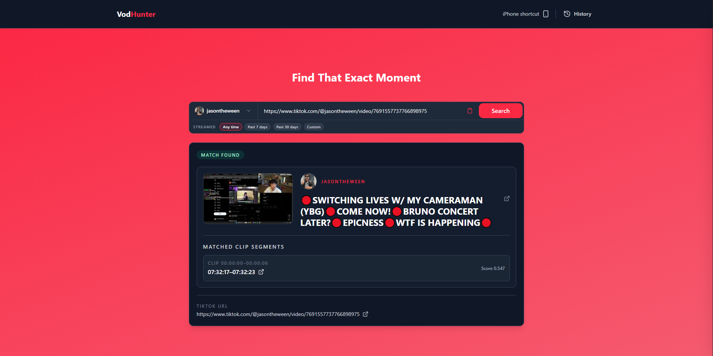
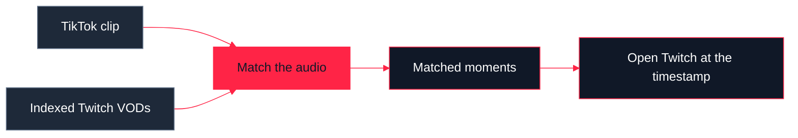

# VodHunter

## [vodhunter.com](https://vodhunter.com/)

Find the original Twitch moments from a TikTok clip. VodHunter matches the clip's
audio to a streamer's VODs and links you to the timestamps. It also works with
edited clips that combine moments from multiple VODs.

## Find a moment

1. Paste a TikTok link, choose a streamer, and click **Search**.
2. Open a match to jump to that moment in the Twitch VOD.

On iPhone, use the site's **iPhone shortcut** button to add VodHunter to your
share sheet and search directly from TikTok.

## How it works

VodHunter saves audio fingerprints from Twitch VODs along with their timestamps.
It compares your TikTok clip's audio fingerprints against them, then checks the
matches to find where each part of the clip appears in the VODs.

*Search covers the VODs VodHunter has indexed for the selected streamer. Very
short clips, heavy music overlays, or heavily altered audio can leave some or
all of a clip unmatched.*

## License

VodHunter's own source is licensed under the MIT License.
